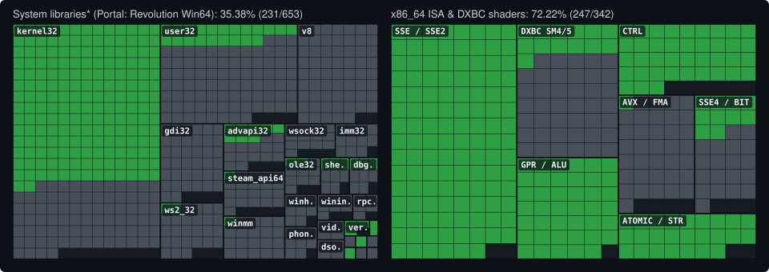
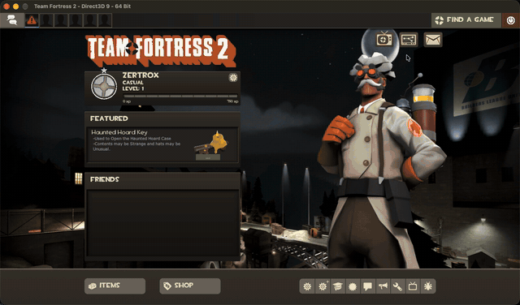
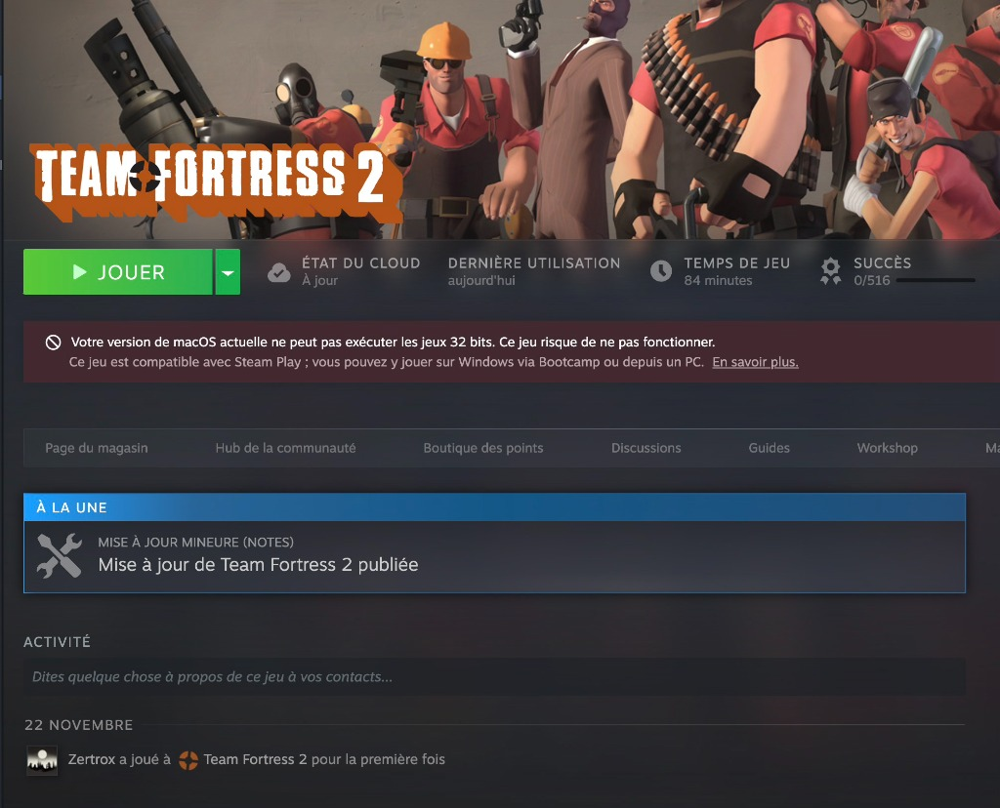
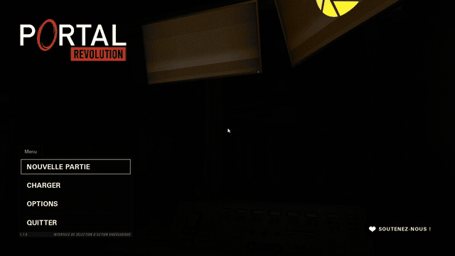
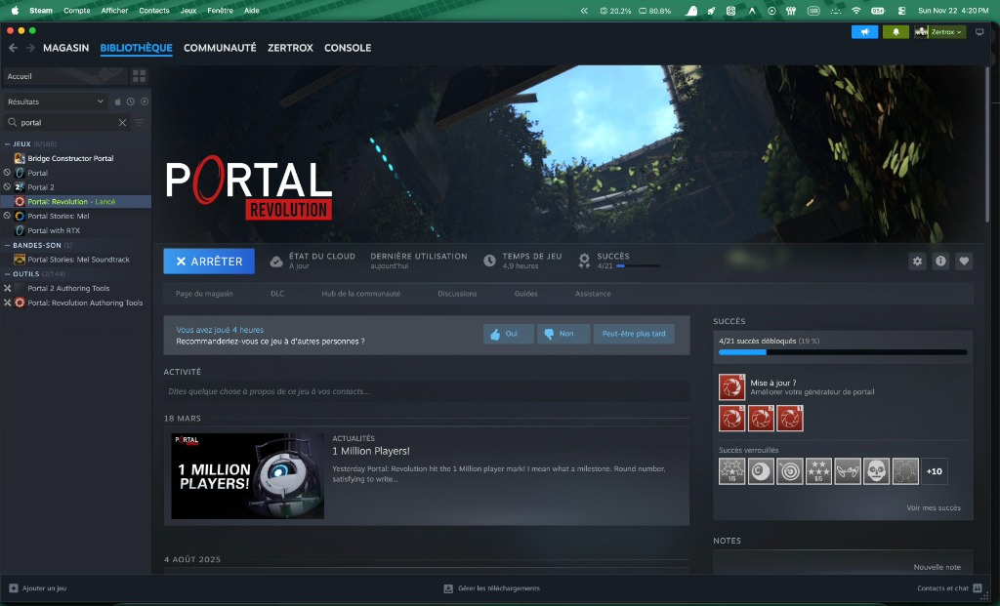

# x64-mac-recomp

Static **x86_64 -> C -> ARM64 macOS** recompiler targeting Windows PE32+ (Win64 + Direct3D 9 via DXVK -> MoltenVK Metal, Direct3D 11 -> Apple Metal) and Linux ELF64 (System V AMD64 + Vulkan -> MoltenVK) — no Rosetta, no Wine, no JIT.

## Status

   



<sub>*System libraries coverage measured against Portal: Revolution Win64 binaries (31 PE64 modules: `revolution.exe`, `launcher.dll`, `tier0.dll`, `vstdlib.dll`, `filesystem_stdio.dll`, `engine.dll`, `materialsystem.dll`, `shaderapidx11.dll`, `stdshader_dx11.dll`, `client.dll`, `server.dll`, `panorama.dll`, `panoramauiclient.dll`, `panorama_text_pango.dll`, etc.). Regenerated with <code>make status</code>.</sub>

## Team Fortress 2

*MacBook Pro M4 Pro — native ARM64 Direct3D 9 (DXVK -> MoltenVK Metal) view*





<sub>Steam flags **Team Fortress 2** as incompatible on modern macOS because the legacy macOS build was 32-bit — `x64-mac-recomp` statically recompiles the official 64-bit Windows build (`tf_win64.exe` + 31 DLLs) straight to native ARM64 macOS with live Steam playtime, Cloud, and Game Coordinator via `libsteam_api.dylib`, official TF2 fonts via CoreText/CoreGraphics GDI, and XAudio2 -> CoreAudio sound. Runs in `-insecure` mode (no VAC): Training, bots, LAN, and non-VAC community servers only (no Valve Casual/Competitive).</sub>

## Portal Revolution

*MacBook Pro M4 Pro — native ARM64 Metal view*





<sub>Native macOS Steam integration — Steam detects **Portal: Revolution** as running on macOS with Cloud sync, playtime tracking, and Steam achievements active through the native `libsteam_api.dylib` pass-through bridge.</sub>

## What is this project for?

**x64-mac-recomp** is an ahead-of-time (AOT) **static recompiler for macOS Apple Silicon (M1/M2/M3/M4)** that turns 64-bit x86_64 Windows (`.exe`/`.dll`) and Linux (ELF64/PIE/``.so``) binaries directly into **native ARM64 macOS executables** — with **no Rosetta, no Wine, no JIT, and no virtualization**.

### What it lets you do

- **Run x86_64 PC games natively on Apple Silicon**: Statically lifts x86_64 machine code into portable C, compiles it with Clang `-O2` directly to ARM64 Mach-O instructions, and bridges OS + GPU calls straight to native macOS frameworks.
- **Direct3D 9 (DXVK -> MoltenVK) & Direct3D 11 (DXBC -> Metal)**: Runs both Windows x64 D3D9 games via DXVK + MoltenVK (with SPIR-V sampler de-aliasing for Apple Metal) and D3D11/DXGI games via live DXBC (SM4/SM5) -> Apple Metal Shading Language (MSL) translation.
- **Native macOS OS bridges**: Bridges Win32 (`kernel32`/`user32`/`ucrtbase`) to SDL2, GDI text/glyph rendering (`GetGlyphOutline`, `ExtTextOut`) to CoreText/CoreGraphics, XAudio2 2.7 to CoreAudio, Steamworks to the local native `libsteam_api.dylib`, and 865+ Vulkan commands (generated from Khronos `vk.xml`) directly to `libMoltenVK.dylib` in a unified 64-bit address space.
- **Verified targets**: Runs **Team Fortress 2** (Source 1 Win64, 32 PE64 modules, D3D9/DXVK -> MoltenVK Metal) and **Portal: Revolution** (Strata Source Win64, 31 PE64 modules, D3D11 -> Metal) natively on Apple Silicon, and is designed as a reusable engine to port additional 64-bit Windows/Linux PC games.

## Architecture

1. **Frontends (`tools/elfprep64.py`, `tools/peprep64.py`)**
   - Unified 64-bit virtual address space above macOS ARM64's GPU carveout (`0x7000000000+`, 16 KiB aligned, 16 MiB module stride) so guest pointers equal native ARM64 pointers.
   - `peprep64.py`: PE32+ `.exe`/`.dll`, `.reloc` (`DIR64`/`HIGHLOW`), cross-DLL imports/exports (ordinals, forwarders, delay-load IATs), `.pdata` `RUNTIME_FUNCTION` roots, PE TLS callbacks & implicit TLS (`gs:[0x58]`), topological `DllMain` init order.
   - `elfprep64.py`: `ET_DYN`/`ET_EXEC`, `DT_RELA`/`DT_JMPREL`, Variant II TLS (`TPOFF64`/`DTPMOD64`/`DTPOFF64`), `COPY`, `IRELATIVE`, multi-`.so` `ld.so` lookup, `init_array`/`fini_array`.
2. **Shared x86_64 -> C Static Lifter (`tools/lift64.py`, `tools/build64.py`)**
   - Disassembles via `objdump -d -M intel`, discovers `call` + RIP-relative `lea` leaf callbacks + `.pdata`/symbol/`data_ptrs` roots + cross-chunk `jmp`/`jcc` root closure, shards across N C files compiled in parallel with SHA-256 object caching.
   - Lifts 8/16/32/64-bit GPRs (mandatory 32->64 zero-extension), `[rip + disp]`, `fs:`/`gs:` TLS/canary/TEB, PIC switch tables, `lock` atomics, `rep` string ops, 128-bit `imul`/`idiv`, and SSE/SSE2/SSE4.1/SSE4.2 (`pcmpistri`).
3. **Runtime & Graphics Bridges (`runtime/`)**
   - Core: `cpu64.h`, `runtime64.c` (exact-VA `mmap`, O(1) dispatch, `rt_invoke64` + `rt_invoke_win64`, TLS + `%fs:0x28` canary + `%gs:0x30` Windows TEB/PEB, crash backtrace handler).
   - Windows/Direct3D 11: `win64_abi.h`, `win32_64.c`, `win32_crt_extra.c` (`kernel32`/`ucrtbase`/`user32` -> SDL2), `dxbc_msl.c` (DXBC SM4/SM5 -> MSL translator), `d3d11_metal.m` (Windows x64 COM vtables -> native Apple Metal).
   - Linux/Vulkan: `libc64.c`, `sdl2_64.c`, `tools/gen_vulkan64.py` + `vulkan64.c` (865+ Vulkan commands from Khronos `vk.xml` -> `libMoltenVK.dylib`).

## Requirements (macOS Apple Silicon)

```sh
brew install sdl2 cairo pango molten-vk vulkan-headers lld
```

## Quick Start: Building Team Fortress 2 on macOS

Because this repository contains **no game files or binaries**, you must supply your own legal Steam copy of **Team Fortress 2** (free-to-play on Steam, AppID `440`):

1. **Download the Windows x64 Steam depots on macOS** — open the Steam console (`open steam://open/console`) and run:
   ```text
   download_depot 440 441
   download_depot 440 232251
   ```
   Wait until Steam prints `Depot download complete` for both depots.
2. **Build & package the standalone macOS `.app` in one command**:
   ```sh
   ./scripts/build_tf2.sh
   ```
   *(Or pass `--game-dir "/path/to/Team Fortress 2"` if you copied an existing Windows Steam installation.)*
3. **Install & play**: open directly or clone into `/Applications` so Spotlight finds **Team Fortress 2**:
   ```sh
   cp -Rc "build/release/Team Fortress 2.app" "/Applications/Team Fortress 2.app"
   open -a "Team Fortress 2"
   ```

The resulting `.app` bundle is fully self-contained (native ARM64 Mach-O binary, 32 `.img` memory images, APFS copy-on-write game assets, bundled MoltenVK/SDL2/SDL3 dylibs, official icon, and ad-hoc code signature — zero Homebrew dependency at runtime).

## Quick Start: Building Portal: Revolution on macOS

Because this repository contains **no game files or binaries**, you must supply your own legal Steam copy of **Portal: Revolution** (free on Steam for Portal 2 owners, AppID `601360`):

1. **Download the Windows x64 Steam depots on macOS** — open the Steam console (`open steam://open/console`) and run:
   ```text
   download_depot 601360 601361
   download_depot 601360 601363
   ```
   Wait until Steam prints `Depot download complete` for both depots.
2. **Build & package the standalone macOS `.app` in one command**:
   ```sh
   ./scripts/build_portal_revolution.sh
   ```
   *(Or pass `--game-dir "/path/to/Portal Revolution"` if you copied an existing Windows Steam installation.)*
3. **Play**: double-click `build/release/Portal Revolution.app` in Finder (or drag it into `/Applications`), or run:
   ```sh
   open "build/release/Portal Revolution.app"
   ```

The resulting `.app` bundle is fully self-contained (native ARM64 Mach-O binary, `.img` memory images, game assets, relocated SDL2/SDL3/Cairo/Pango/FreeType/Fontconfig dylibs, Fontconfig config, and ad-hoc code signature — zero Homebrew dependency at runtime).

For custom targets, you can invoke `tools/build64.py` and `tools/package_macos_app.py` directly.

## Verification

```sh
make check
# Or with UndefinedBehaviorSanitizer:
CFLAGS="-fsanitize=undefined -fno-sanitize-recover=all" LDFLAGS="-fsanitize=undefined" make check
```

`make check` compiles and executes four real x86_64 end-to-end test suites (plus unit tests):
- `test-smoke`: Linux ELF64 PIE + `libcalc.so` (128-bit math, switch table, SSE2, stack canary, `qsort` callback, Linux 144-byte `stat`, 4 pthreads + `lock inc`).
- `test-vulkan`: Linux ELF64 -> SDL2 -> MoltenVK on Apple Silicon GPU.
- `test-win64`: Windows PE32+ `.exe` + `.dll` (`DllMain`, 6-arg Win64 shadow space, `gs:[0x30]` TEB, `HeapAlloc`, `VirtualAlloc`, `QPC`, `GetProcAddress`, `qsort`, 4 Win32 `CreateThread` + `CRITICAL_SECTION` + `TlsAlloc`).
- `test-d3d11`: Windows PE32+ Direct3D 11 + DXGI -> Apple Metal GPU (DXBC SM4.0 shaders -> MSL, clear + triangle `Draw` + staging `CopyResource`/`Map` pixel readback).

## Legal & Disclaimer

- **Clean-room interoperability tool**: `x64-mac-recomp` is an independent, MIT-licensed static recompiler and runtime bridge. It contains **no copyrighted game assets, binaries, source code, shaders, or proprietary SDK files** from Valve Corporation, Second Face Software, Microsoft, or any third party.
- **Legally owned copies only**: End users must supply their own legally obtained Steam copy of any game they recompile. The Steamworks bridge delegates authentication and initialization (`SteamAPI_InitSafe`) to the user's locally installed native macOS Steam client and does not bypass DRM or ownership checks.
- **Third-party licenses**: The generated Vulkan bridge (`tools/gen_vulkan64.py`) parses Khronos `vk.xml` (Apache-2.0) at build time. When packaging a local `.app` with `tools/package_macos_app.py`, third-party libraries (SDL2/SDL3 under zlib; Cairo/Pango/GLib/FriBidi under LGPL-2.1; FreeType under FTL/GPL-2.0; HarfBuzz/Pixman/Fontconfig/libpng under MIT/BSD/zlib) are dynamically linked as separate `.dylib` files inside `Contents/Frameworks/` — do not redistribute bundles containing third-party copyrighted game files.
- **Trademarks**: *Team Fortress 2*, *Portal*, *Portal 2*, *Steam*, and *Source* are trademarks of Valve Corporation. *Portal: Revolution* and *Strata Source* are trademarks of their respective owners (Second Face Software / Strata Source team). *DirectX* and *Windows* are trademarks of Microsoft Corporation. *macOS*, *Apple Silicon*, and *Metal* are trademarks of Apple Inc. This project is unofficial and not affiliated with or endorsed by any of these entities.
